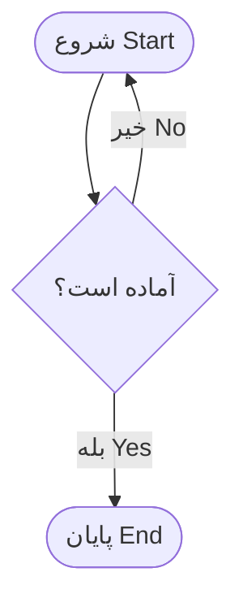

# Khana

A local desktop reader and source editor for mixed Persian and English documents. Create, open, edit, and save Markdown or HTML with a live preview. Each paragraph is displayed in its own direction. The application interface is English; document content keeps its original language.

## Install on Ubuntu

Use **[khana_0.3.0-1_amd64.deb](dist/khana_0.3.0-1_amd64.deb)** for normal desktop integration on **Ubuntu 26.04 x86_64**. This package installs the name **Khana**, the book logo in multiple sizes, and a system application entry for search, the dock, and Open With. It includes Python, Qt, fonts, and offline diagrams; a Git repository and a separate Python installation are not required.

Install using the system package installer, or from this project folder:

```bash
sudo apt install ./dist/khana_0.3.0-1_amd64.deb
```

Installation requires your Ubuntu administrator password. Close the old portable window, search for **Khana** in **Show Applications**, and launch the installed entry. Right-click its icon and select **Pin to Dash** / **Add to Favorites**. The internal ID `io.khana.Khana` stays consistent between Qt, Wayland, the desktop file, and the icon theme; the displayed name is **Khana**.

The package installs into `/opt/khana`, provides `/usr/bin/khana`, and registers `/usr/share/applications/io.khana.Khana.desktop` with icons under `/usr/share/icons/hicolor`. Standard system package triggers update the desktop and icon caches. It does not replace your default HTML/Markdown application or modify your favorites automatically.

To uninstall, run `sudo apt remove khana`. Your documents and settings are retained; preferences stay in `~/.config/Khana/Khana/settings.ini` (or beneath `XDG_CONFIG_HOME`). Install a newer `.deb` with the same command to upgrade. Older Ubuntu versions and other CPU architectures require their own builds.

To rebuild the installer:

```bash
.venv/bin/python -m pip install -r requirements-build.txt
.venv/bin/python scripts/build_deb.py
```

This rebuilds the unpacked runtime and packages it with the desktop entry and SVG/PNG logo. The build needs `curl`, `dpkg-deb`, and `desktop-file-validate`. The installed runtime starts directly from its installed directory, without extracting the single-file runtime on every launch.

## Portable desktop app

The built Linux application is **[dist/Khana](dist/Khana)**. Double-click it to start; Python, pip, and the source project are not needed. The executable contains the interface, fonts, offline Mermaid renderer, sample documents, Python, and Qt WebEngine. It starts fullscreen; press **F11** to switch to a regular window. Allow a few seconds at startup for the embedded runtime to unpack.

This build targets **Ubuntu 26.04, Linux x86_64**. It is not a Windows executable and compatibility with older Linux distributions has not been verified. You can move the single `Khana` file to another folder. Its settings live in `~/.config/Khana/Khana/settings.ini` (or beneath `XDG_CONFIG_HOME`), independently of the executable and its temporary resources.

The portable executable and its optional `dist/io.khana.Khana.desktop` launcher do not register an installed app. Use the `.deb` package above for application search and reliable dock integration. The portable launcher references the current build folder; keep it beside `dist/khana.svg`, or update its `Exec` and `Icon` entries if you move the app. `dist/SHA256SUMS` contains the portable executable's checksum.

To rebuild on Ubuntu 26.04 x86_64 with `curl` and `dpkg-deb` installed:

```bash
.venv/bin/python -m pip install -r requirements-build.txt
.venv/bin/python scripts/build_linux.py
```

The build downloads eight small X11 support libraries from the Ubuntu archive into `build/linux-libs`, verifies their pinned hashes, and bundles them without installing system packages. Subsequent builds reuse the downloads. The PyInstaller configuration is in `packaging/khana.spec`; `--onedir` builds an unpacked verification bundle in `build/onedir/Khana`. Third-party license notices are included with the embedded resources.

To verify the actual executable on a graphical desktop:

```bash
.venv/bin/python tests/bundle_smoke.py dist/Khana
```

This launches the packaged app outside the project with temporary preferences and documents, checks offline rendering, builders, HTML, saving, and settings across restarts, and saves a screenshot in `artifacts/`. A local DevTools endpoint is enabled only in that test process.

## Run

Requires Python 3.10 or newer and a graphical desktop session.

```bash
python3 -m venv .venv
.venv/bin/python -m pip install -r requirements.txt
.venv/bin/python main.py
```

The dependencies are already installed in this workspace's `.venv`. In PyCharm, select this virtual environment and run `main.py`.

On Windows:

```powershell
py -m venv .venv
.venv\Scripts\python -m pip install -r requirements.txt
.venv\Scripts\python main.py
```

You can also pass one or more files at startup:

```bash
.venv/bin/python main.py examples/welcome.md examples/mixed-content.html
```

The window starts fullscreen. Press **F11**, or click the F11 button, to return to a regular window. The top-right close button exits the application.

## Reading

- Open `.md`, `.markdown`, `.mdown`, `.mkd`, `.txt`, `.html`, or `.htm` files with **Open file**, drag and drop, or the command line.
- Keep several documents open and use **ON THIS PAGE** to jump to headings.
- **Smart** detects each paragraph, heading, list item, and table cell independently. A Persian sentence beginning with an English product name remains right to left. Primarily English paragraphs remain left to right.
- Code blocks remain left to right. English phrases, inline code, paths, and URLs are isolated from surrounding Persian text. English phrases spanning emphasis or links are kept together.
- **RTL** and **LTR** override the document direction. Hover beside a paragraph or heading to cycle that individual block through RTL, LTR, and automatic direction. These overrides last while the file remains open and reset when it is reloaded.
- Search highlights text across inline formatting. Use Enter / Shift+Enter or the arrow buttons to move through matches. Up to 2,000 matches are highlighted.
- Adjust font size, line spacing, page width, light/dark theme, or focus mode. Preferences are stored locally in `.local/settings.ini`.
- **Reload** reads a file again after changes in another editor. If you have local edits, choose Save, Discard, or Cancel before reloading.

## Create, edit, and save

- Select **MD** or **HTML** beside **New document**, then click the button (or press Ctrl+N) to create a draft.
- Select **Edit & Preview** (Ctrl+E) to edit the original source beside a live preview. The preview updates after a brief pause in typing. Use **Read** to return to the full reading layout.
- Each document keeps its own source buffer and undo history while switching tabs or reading modes. Standard Ctrl+Z / Ctrl+Shift+Z editing shortcuts work in the source field.
- The editor has independent **Auto / LTR / RTL** direction controls. The reading toolbar controls the preview direction.
- The source toolbar provides **Bold**, **Italic**, **Strikethrough**, **H1–H3**, **Link**, **Inline code**, **Code block**, **Quote**, **Bulleted list**, **Numbered list**, and **Horizontal rule**. Select source text and choose a button; without a selection, inline tools insert a selected placeholder. Headings and Markdown lists act on the selected/current lines.
- Formatting inserts Markdown syntax in Markdown documents and HTML tags in HTML documents. The result appears in the preview. Toolbar operations are undoable with Ctrl+Z. The link dialog supports a label and an HTTP(S), mailto, heading, or relative document destination.
- **Save** (Ctrl+S) updates the current file. A new draft opens a filename dialog; a missing extension is added automatically. Sample documents also use a filename dialog.
- **Save As…** (Ctrl+Shift+S) writes to a new name or location and makes that the active file. Later saves update the new path. Source format is preserved: this is not Markdown-to-HTML export.
- An amber dot and **Unsaved changes** identify modified documents. Closing a modified file, reloading it, or closing the application offers **Save / Discard / Cancel**. Canceling a filename dialog keeps the draft open.
- Opening an already open file activates its existing buffer. Save As cannot overwrite a file that is open in another tab.
- Saving writes the original source, including HTML styles and scripts; sanitization applies only to the preview. Existing UTF-8 / UTF-16 encoding, byte-order marks, and newline style are retained. New documents use UTF-8.
- Files are written through a temporary file and an atomic commit. Save errors leave edits open. If a file changed on disk, replacement requires confirmation. Drafts live in memory until saved; there is no automatic recovery after a crash.

| Shortcut | Action |
| --- | --- |
| Ctrl+O | Open files |
| Ctrl+N | New document in the selected format |
| Ctrl+E | Toggle Edit & Preview |
| Ctrl+S | Save |
| Ctrl+Shift+S | Save As |
| Ctrl+W | Close the current document |
| Ctrl+B | Toggle bold in the source editor |
| Ctrl+I | Toggle italic in the source editor |
| Ctrl+K | Insert a link |
| Ctrl+Shift+X | Toggle strikethrough |
| Ctrl+` | Inline code |
| Ctrl+Z / Ctrl+Shift+Z | Undo / redo source editing |
| Ctrl+F | Find in the current document |
| Ctrl+R | Reload from disk |
| Ctrl+Shift+F | Toggle focus mode |
| F11 | Toggle fullscreen |
| Escape | Close appearance/search, or leave focus mode |

## Tables and flowcharts

In **Edit & Preview**, place the caret in the source and choose **Table** or **Flowchart**. Insertion replaces selected source text, if any, and supports Ctrl+Z / Ctrl+Shift+Z.

- **Table** opens an editable grid with a header row and 1–50 data rows, with up to 12 columns. Fill the cells or paste tab-separated cells from a spreadsheet. Pasting expands the grid within those limits; oversized pastes show an error. Cells support Persian and English. Markdown cells may use inline Markdown formatting; HTML cell contents are escaped as literal text.
- **Flowchart** lets you add and remove steps, choose **Process**, **Start / End**, **Decision**, or **Input / Output** shapes, and connect them with optional labels. Branches and loops are supported. Choose top-to-bottom, bottom-to-top, left-to-right, or right-to-left layout. A chart can have up to 30 steps and 60 connections in the builder.
- Diagrams render offline in both reading mode and live preview, with mixed-language labels, light/dark themes, zoom, **Fit**, **Copy source**, and an expandable **Mermaid source** section. Invalid diagrams show an error beside their source while the rest of the document stays readable.
- The builders insert editable source. To change an existing table or flowchart, edit that source in **Edit & Preview**. The forms currently create new items; they do not reopen existing ones for visual editing.

Markdown diagrams use standard Mermaid fences:

````markdown

````

HTML diagrams use `<pre><code class="language-mermaid">…</code></pre>` with HTML-escaped Mermaid source. Saving preserves this source; displaying it in another application requires Mermaid support. This is not a standalone HTML/SVG export.

Open [examples/tables-and-flowcharts.md](examples/tables-and-flowcharts.md) for a table, a branching order process, and a right-to-left release pipeline. Rendering limits are 50,000 source characters and 200 edges per diagram. Diagrams run in strict mode; graph links and embedded HTML/images are disabled and application security/theme settings cannot be overridden by document directives.

## HTML and local files

HTML is displayed in a consistent reading layout: headings, paragraphs, lists, links, tables, images, code, and disclosure sections. Scripts, forms, embedded pages, and the original page's CSS are removed. Existing HTML `dir="rtl"` / `dir="ltr"` hints are honored in Smart mode.

No server or internet connection is needed after installation. No content is uploaded. Images load from the document's folder and its subfolders; remote images are replaced by placeholders. External links open in your default browser only when clicked. Relative Markdown/HTML links inside the document's folder open in Khana.

Files must use UTF-8 (with or without BOM) or UTF-16 with BOM and be no larger than 5 MB. Raw HTML embedded inside Markdown is shown as text. Smart direction is a heuristic; use the manual direction controls for ambiguous sentences.

## Project layout

| Path | Responsibility |
| --- | --- |
| `main.py` | Application entry point |
| `reader/desktop.py` | Qt window, file dialogs, document sessions, preview workers, save/close prompts |
| `reader/documents.py` | Document loading, Markdown rendering, HTML sanitization |
| `reader/editing.py` | Source buffers, encoding preservation, conflict detection, atomic writes |
| `reader/web/bidi.js` | Direction detection and inline isolation |
| `reader/web/app.js` | Reading interface and document state |
| `reader/web/formatting.js` | Selection transformations for formatting and links |
| `reader/web/insertions.js`, `reader/web/builders.js` | Table/flowchart serialization and builder dialogs |
| `reader/web/diagrams.js` | Offline diagram rendering, direction, themes, and zoom |
| `reader/web/styles.css`, `reader/web/editor.css` | Themes, typography, and reading/editor layouts |
| `reader/web/builders.css` | Builder forms and diagram presentation |
| `examples/` | Persian/English Markdown and HTML samples |

The renderer is shared by the reading view and live preview. Source buffers stay separate from rendered HTML so saving never replaces the original source with the sanitized preview.

## Checks

```bash
.venv/bin/python -m unittest discover -s tests -p 'test_*.py' -v
node --test tests/bidi.test.cjs
node --test tests/formatting.test.cjs
node --test tests/insertions.test.cjs
.venv/bin/python tests/desktop_smoke.py
.venv/bin/python tests/editor_smoke.py
.venv/bin/python tests/builders_smoke.py
```

The last three checks require a graphical desktop and exercise the actual Qt/WebEngine window, reading, editing, live preview, saving, save-as, external changes, save/discard/cancel behavior, table/flowchart builders, and diagram rendering. They use temporary files and save screenshots in `artifacts/`. Node is only needed for JavaScript unit tests, not to run the app.

The bundled Noto Sans Arabic font's license is included in `reader/web/fonts/LICENSE.txt`. PySide6/Qt and the other dependencies retain their respective upstream licenses.

Mermaid 11.12.2 is bundled locally under the MIT license; see [vendor notes](reader/web/vendor/README.md) and `reader/web/vendor/MERMAID-LICENSE.txt`. No CDN access is used at runtime.
