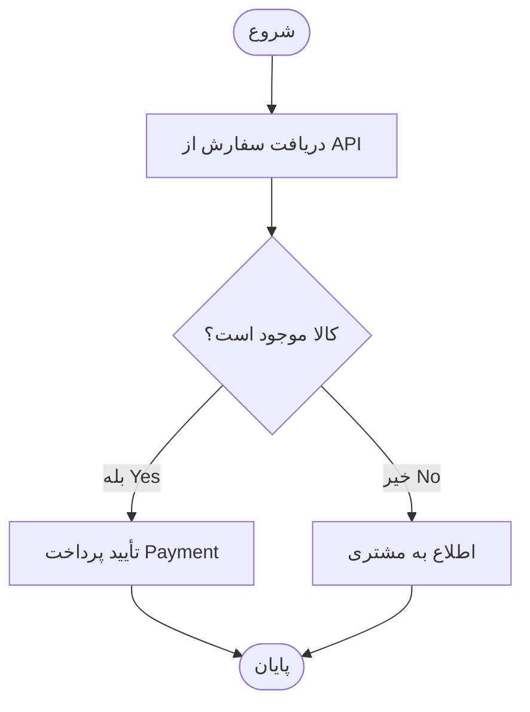

# جدول و فلوچارت — Tables & Flowcharts

این نمونه یک جدول فارسی و انگلیسی و نمودار مراحل ثبت سفارش را نشان می‌دهد.
برای ساخت نمونهٔ خودتان وارد **Edit & Preview** شوید و از دکمه‌های **Table** و **Flowchart** استفاده کنید.

## جدول وضعیت

| مرحله | Component | وضعیت |
| --- | --- | --- |
| دریافت سفارش | API | انجام شد |
| بررسی موجودی | Inventory | در حال بررسی |
| تأیید پرداخت | Payment | در انتظار |

## مراحل ثبت سفارش

می‌توانید متن مرحله‌ها و اتصال‌ها را در بخش منبع تغییر دهید؛ نمودار به‌صورت زنده به‌روزرسانی می‌شود.

## یک مسیر از راست به چپ

